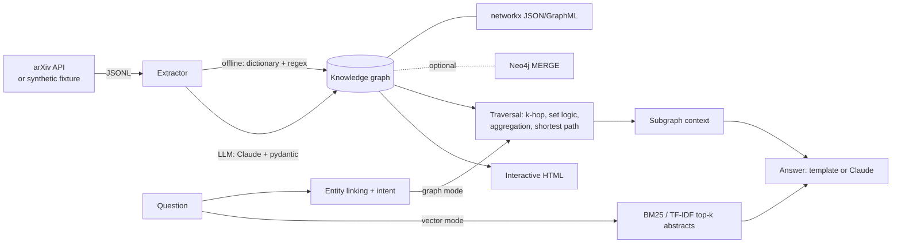

<p align="center"></p>

# neuro-graphrag

GraphRAG for brain-computer-interface research: it turns EEG/BCI paper abstracts into a knowledge graph
(papers, methods, datasets, paradigms, metrics) and answers multi-hop research questions that plain
vector/lexical RAG gets wrong, such as "which methods are used for both motor imagery and P300?" or
"count papers per method on motor imagery". It runs fully offline (curated dictionary + regex extractor,
template answers); when `ANTHROPIC_API_KEY` is set it can use Claude for extraction and for composing answers.

> **Synthetic data notice.** `data/fixture_abstracts.jsonl` contains 12 short **synthetic** abstracts with
> fictional titles and authors. They exist only so the tests, the evaluation and the offline demo are
> deterministic. They are not real papers and their numbers are invented. Real abstracts come from the arXiv
> API via `neurograph fetch` (a 47-abstract real sample is included in `data/arxiv_sample.jsonl`).

## Features

- **Fetcher**: real abstracts from the public arXiv API (`export.arxiv.org`) to JSONL, 3 s pause between requests, de-duplicated.
- **Schema**: `Paper -USES_METHOD-> Method`, `-EVALUATED_ON-> Dataset`, `-STUDIES-> Paradigm`, `-REPORTS-> Metric` (with value), `Method -IS_A-> MethodFamily`; recording attributes (channels, sampling rate) on papers.
- **Two extractors**: offline dictionary + regex; Claude (`claude-opus-5-5`, official `anthropic` SDK) returning JSON validated with pydantic.
- **Stores**: networkx (JSON / GraphML persistence) by default; optional Neo4j adapter (Cypher `MERGE`) behind the same interface.
- **Two answer modes**: BM25 / TF-IDF baseline over abstracts, and GraphRAG (entity linking, k-hop traversal, set logic, aggregation, shortest paths, subgraph context).
- **Evaluation**: 10 multi-hop questions with known answers over the synthetic corpus, vector vs graph.
- **Visualisation**: self-contained interactive HTML (vis-network).

## Quick start

```bash
python -m pip install -e ".[dev]"        # Python 3.12; add ,llm and/or ,neo4j extras if wanted
neurograph build --input data/fixture_abstracts.jsonl --out out/graph.json --html out/graph.html
neurograph stats
neurograph ask "Which papers use a spatial filter method on motor imagery?" --mode graph
neurograph ask "Which papers use a spatial filter method on motor imagery?" --mode vector
neurograph eval                          # vector vs graph, offline
pytest -q

# real data (needs network)
neurograph fetch --max-results 25 --out data/arxiv.jsonl
neurograph build --input data/arxiv.jsonl --out out/arxiv_graph.json
```

With `ANTHROPIC_API_KEY` set, `build` (`--extractor auto`) uses Claude and `ask` composes the final answer with Claude
from the retrieved context; force the offline path with `--extractor offline` / `--no-llm`. Neo4j:
`pip install ".[neo4j]"`, set `NEO4J_URI`, `NEO4J_USER`, `NEO4J_PASSWORD` (see `.env.example`), then `neurograph build --store neo4j`.

## Example output (real, offline, synthetic corpus)

```
$ neurograph build --extractor offline
extractor: offline; papers: 12
graph: 46 nodes, 75 edges -> out/graph.json

$ neurograph ask "Which papers use a spatial filter method on motor imagery?" --mode graph
Papers matching spatial filter + motor imagery: syn-01 (...); syn-03 (...); syn-12 (...).

$ neurograph ask "Which papers use a spatial filter method on motor imagery?" --mode vector
Top retrieved abstracts: syn-03; syn-06 (a P300 paper); syn-12     <- misses syn-01, includes a wrong paradigm

$ neurograph ask "Which methods are used for both motor imagery and P300?" --mode graph
Methods linked to motor imagery AND P300: EEGNet, LDA, Riemannian tangent space, SVM. Supporting papers: syn-01, syn-02, syn-03, syn-05, syn-06, syn-09.

$ neurograph ask "How are fuzzy classifier and EEGNet connected?"
Fuzzy classifier and EEGNet are 4 hops apart. Example path: Fuzzy classifier -- syn-12 -- motor imagery -- syn-02 -- EEGNet. Bridging entities: motor imagery.

$ neurograph ask "Count papers per method on motor imagery."
Papers per method for motor imagery: CSP=2, Fuzzy classifier=2, SVM=2, DeepConvNet=1, EEGNet=1, FBCSP=1, LDA=1, ...
```

On the 47 real arXiv abstracts in `data/arxiv_sample.jsonl` the offline extractor builds a 75-node / 110-edge graph, and
"Count papers per method on motor imagery" returns `EEGNet=7, CSP=2, Transformer=2, DeepConvNet=1, FBCSP=1, LSTM=1, ShallowConvNet=1`
(counts reflect only that small sample and the dictionary's coverage; they are not a literature survey).

## Evaluation (offline, synthetic corpus, 10 questions)

`neurograph eval` scores each answer as set F1 against hand-written gold answers (`data/eval_questions.json`).
"vector" = BM25 top-k retrieval, then the same dictionary "reads" the retrieved abstracts (no traversal or set logic).
"graph" = GraphRAG traversal.

| id | hops | graph | vector (k=3) | vector (k=5) |
|---|---|---|---|---|
| q1 spatial filter + motor imagery | 2 | 1.00 | 0.67 | 0.75 |
| q2 CNN methods on BCI IV 2a | 3 | 1.00 | 1.00 | 1.00 |
| q3 methods used for both MI and P300 | 3 | 1.00 | 0.89 | 0.62 |
| q4 papers per method on MI (count) | 2 | 1.00 | 0.35 | 0.63 |
| q5 datasets used for P300 studies | 2 | 1.00 | 1.00 | 1.00 |
| q6 highest accuracy on BCI IV 2a | 2 | 1.00 | 1.00 | 1.00 |
| q7 classical ML methods on SSVEP | 3 | 1.00 | 1.00 | 1.00 |
| q8 papers using both EEGNet and SVM | 2 | 1.00 | 0.50 | 0.33 |
| q9 path: fuzzy classifier to EEGNet | 4 | 1.00 | 0.67 | 0.50 |
| q10 methods on Benchmark SSVEP | 2 | 1.00 | 1.00 | 1.00 |
| **mean F1** | | **1.00** | **0.81** | **0.78** |
| **exact match** | | **10/10** | **5/10** | **5/10** |

TF-IDF cosine retrieval gives the same totals. **Read this honestly:** the questions and gold answers were written by
the author for a 12-document corpus, with the same dictionary used for entity linking, so graph mode reaching 1.00 is
close to a ceiling, not evidence of general accuracy. What the table does show is *where* retrieval alone fails:
conjunctions, bridging across paradigms, aggregation and paths (q1, q3, q4, q8, q9), while single-hop lookups (q2, q5, q6, q7, q10)
are tied. A real LLM reader over the retrieved abstracts would likely do better than this deliberately simple baseline reader.

## Architecture



## Research motivation

Literature review in BCI is relational by nature. The useful questions are rarely "which paper mentions X" but
"which *family* of methods has been tried on *which paradigm* with *which dataset*", "which methods transfer across
paradigms", or "where is nothing published". Abstracts rarely state these relations in one sentence: a paper says
"CSP" and never "spatial filter", reports its dataset in one sentence and its paradigm in another. Similarity search
returns passages that look like the query; it cannot intersect constraints (EEGNet AND SVM), count, or follow
Paper -> Method -> Family chains. An explicit graph makes these operations exact and auditable (every answer lists its
supporting papers), and it exposes structure, such as hubs (BCI Competition IV 2a), bridges between paradigms and
method-paradigm gaps (in the fixture, no fuzzy classifier or Transformer appears outside motor imagery), that a ranked list hides.

## How it works

1. `ontology.py`: curated dictionary of methods (with family), datasets, paradigms and metrics; longest-match, non-overlapping linking.
2. `extract_offline.py` / `extract_llm.py`: dictionary + regex (accuracy, kappa, AUC, F1, ITR, channel count, sampling rate) or Claude with a JSON schema, validated by pydantic and canonicalised through the same ontology.
3. `build.py` + `store.py`: idempotent upserts into networkx (or Neo4j with `MERGE`).
4. `query.py`: the question is linked to entities and an intent (list, count, count-per, argmax, path, "both"); papers are selected by traversal and intersected/unioned per slot; targets are read off the selected papers' neighbours; an answer and a subgraph context (one fact line per paper) are produced. Path search ignores Metric nodes, which would otherwise connect everything through "accuracy".
5. Vector mode shares the parser but only retrieves top-k abstracts and reads entities out of them.

## Project structure

```
src/neurograph/   schema, ontology, extractors, store, build, vector, query, llm, evaluate, viz, cli
data/             fixture_abstracts.jsonl (synthetic), eval_questions.json, arxiv_sample.jsonl (real arXiv metadata)
tests/            extractor, graph/store, traversal queries, eval runner, fetch/viz (all offline, ~1 s)
.github/workflows/ci.yml
```

## Limitations

- Offline extraction is a dictionary: it only finds what is listed in `ontology.py`, cannot disambiguate (e.g. "transformer" in a non-ML sense) and will take the maximum of several accuracy numbers in one abstract (including baselines). Abstracts only: no full text, no per-subject or per-condition results.
- The question parser is rule-based and handles a fixed set of intents; free-form questions need the LLM path, which composes answers from the traversal's context but still depends on the rule-based entity linking.
- The evaluation is small, author-written and favourable to the graph (see above); the vector baseline is lexical (BM25/TF-IDF), not a neural embedding model.
- The LLM extractor and LLM answer composition are implemented and unit-tested against a stub client; they have not been benchmarked here.
- The Neo4j adapter is tested only against a fake driver, not a live database. Queries run on the networkx view.
- Reported accuracies are not comparable across papers (different protocols, subject splits, cross-validation); the graph records what is stated, not whether it is comparable.

## Future work

Directions this tool is meant to support in doctoral-level research:

- **Cross-dataset generalisation**: link papers to evaluation protocols (within-subject, cross-subject, cross-dataset) and query which methods have ever been validated across datasets.
- **Method-paradigm gap analysis**: list (method family, paradigm) pairs with no papers, and rank them by how well neighbouring pairs perform.
- Open-vocabulary extraction with Claude plus ontology growth; entity resolution of aliases at scale.
- Embedding-based retrieval baseline and hybrid graph + vector retrieval; larger real-data gold set annotated by hand.
- Temporal queries (method adoption over years) and citation edges.

## License

MIT, see `LICENSE`.
